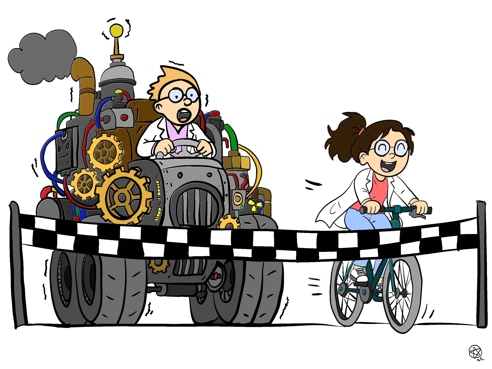
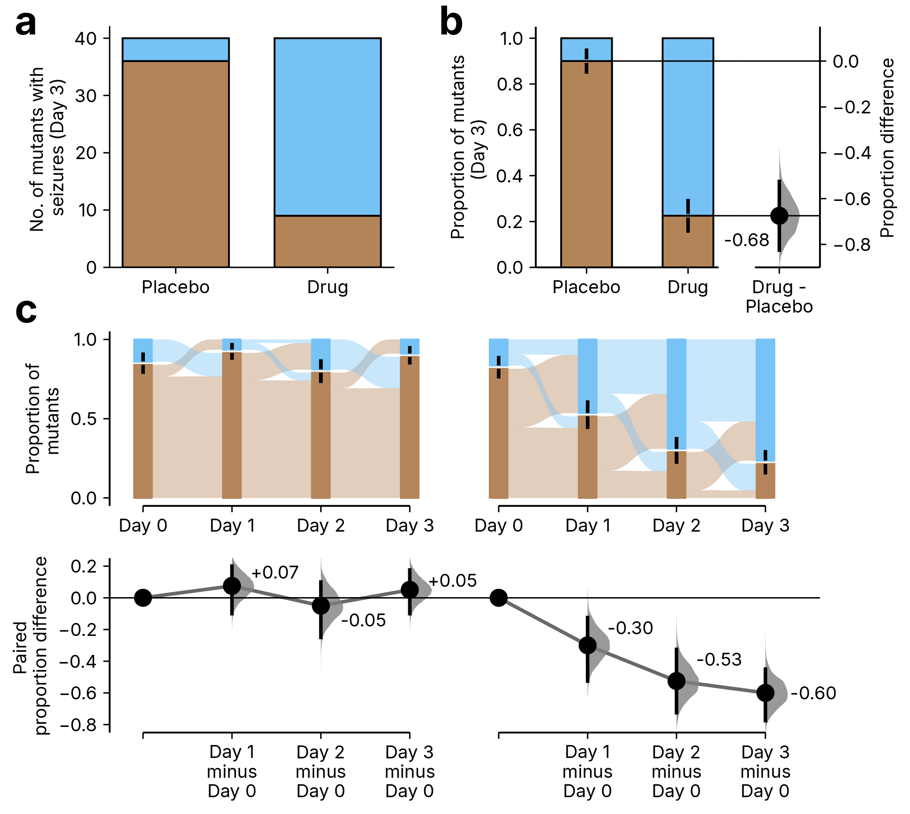
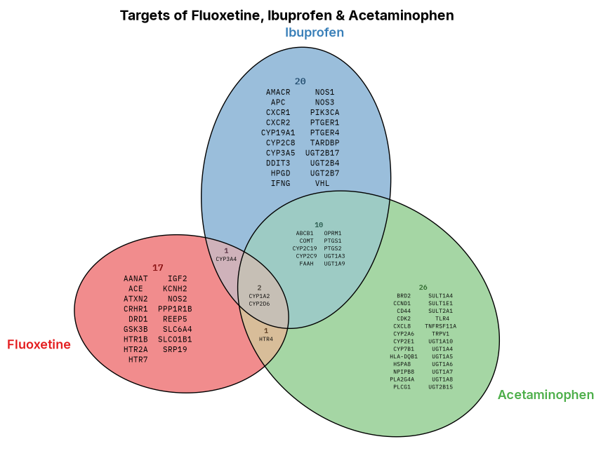

```{=html}
<!--
  The design and template of this site (its visual and interaction design: theme, colours,
  typography, and the card / hover / layout system) is the original work of Nicole M. Lee and
  may be reused with credit under CC BY 4.0.
  All written text and images are her content, all rights reserved, and are NOT for reuse.
  Source and full terms: https://github.com/mnicolee/Portfolio  (see LICENSE and AGENTS.md)
  📷 headshot → nicole.png
-->

<!-- HERO: round headshot (left) · name, subtitle and first about paragraph (right) -->
<div class="hero">
  
  <div class="hero-text">
    <div class="hero-name" role="heading" aria-level="1">Nicole M. Lee, Ph.D.</div>
    <div class="hero-sub">Computational behavioral neuroscientist &amp; hardware tinkerer</div>
    <p class="lead-p hero-lead">I'm a <strong>neuroscientist</strong> in the <a href="https://claridgechang.com/">ACC Lab</a> (Adam Claridge-Chang) at Duke-NUS Medical School, where I completed my PhD and now continue as a Research Fellow, <strong>building optogenetic methods to study how small circuits in the <em>Drosophila</em> brain shape behavior.</strong></p>
  </div>
</div>

<!-- ABOUT (continued, full width) — no label per Nicole -->
<div class="hsec">
  <p class="lead-p">Before the flies, I completed my B.S. in Biochemistry at the University of Washington in Seattle. While there, I worked on several projects: the <a href="https://orthop.washington.edu/research/ourlabs/collagen-biology-and-genetic-disorders-lab.html">biochemistry of collagen degradation</a>, <a href="https://depts.washington.edu/uwconte/chavkinlab/">mTOR and kappa-opioid receptor signaling</a>, <a href="https://cabernardlab.org/overview">asymmetric cell division</a>, and <a href="https://csi.nus.edu.sg/">cancer drug-resistance</a>. Outside the lab, I paint 🎨, play games 🎮, and build apps 📱.</p>
</div>

<!-- THE THREE: icon inline with title, blurb below -->
<div class="hsec">
  <div class="three">
    <div class="col">
      <div class="k-row">
        <span class="kt"><span class="ic ic--brain"><svg viewBox="0 0 48 48" aria-hidden="true"><path d="M24 10 C20 7 14 8 13 13 C8 13 6 19 10 22 C7 25 9 31 14 30 C15 34 22 34 24 30 C26 34 33 34 34 30 C39 31 41 25 38 22 C42 19 40 13 35 13 C34 8 28 7 24 10 Z"/><path d="M24 10 L24 30"/><path d="M17 16 C20 18 20 22 17 24"/><path d="M31 16 C28 18 28 22 31 24"/></svg></span>The neuroscience</span>
      </div>
      <div class="kd"><strong>Optogenetics for behavioral neuroscience</strong>, developing and applying light-driven tools to manipulate neural activity, including potassium channelrhodopsins and opto-GPCRs.</div>
    </div>
    <div class="col">
      <div class="k-row">
        <span class="kt"><span class="ic ic--wrench"><svg viewBox="0 0 48 48" aria-hidden="true"><path d="M45.4 38 l-18.2 -18.2 c1.8 -4.6 .8 -10 -3 -13.8 -4 -4 -10 -4.8 -14.8 -2.6 L18 12 12 18 3.2 9.4 C.8 14.2 1.8 20.2 5.8 24.2 c3.8 3.8 9.2 4.8 13.8 3 l18.2 18.2 c.8 .8 2 .8 2.8 0 l4.6 -4.6 c1 -.8 1 -2.2 .2 -2.8 z"/></svg></span>The nuts &amp; bolts</span>
      </div>
      <div class="kd"><strong>Experimental hardware design</strong>, designing and prototyping custom rigs and hardware components for optogenetic stimulation and behavioral experiments.</div>
    </div>
    <div class="col">
      <div class="k-row">
        <span class="kt"><span class="ic ic--plot"><svg viewBox="0 0 48 48" aria-hidden="true"><path d="M6 35 H42"/><path d="M9 35 C18 35 18 11 24 11 C30 11 30 35 39 35"/><path d="M24 15 V37"/><circle class="dot" cx="24" cy="25" r="3"/></svg></span>The numbers</span>
      </div>
      <div class="kd">
        <p><strong>Estimation statistics</strong>, contributing to <a href="papers/dabest/index.html">DABEST</a> for effect sizes and confidence intervals over p-values.</p>
        <p>Building open-source Python packages for <strong>data analysis and visualization</strong>.</p>
      </div>
    </div>
  </div>
</div>

<!-- RECENT NEWS: auto-looping slideshow (newest first); each slide = name, picture, blurb
     RULE: exactly THREE slides, always. When news comes in, add it as the new first slide and
     delete the oldest one from the rotation. Do not let this grow to four. Keep the static
     counter below reading "1 / 3" to match.
     RULE: the gold <span class="tag tag-new">Just out</span> badge belongs to the newest slide
     only. Move it onto the incoming slide and strip it from the one it used to be on, so exactly
     one slide carries it at a time. -->
<div class="hsec hsec-last">
  <div class="show" data-interval="5000" aria-roledescription="carousel" aria-label="Recent news">
    <div class="show-top">
      <div class="eyebrow">Recent news</div>
      <div class="show-nav">
        <button class="nav-btn prev" type="button" aria-label="Previous news"><svg viewBox="0 0 24 24" aria-hidden="true"><path d="M15 5l-7 7 7 7"/></svg></button>
        <span class="counter" aria-live="polite">1 / 3</span>
        <button class="nav-btn next" type="button" aria-label="Next news"><svg viewBox="0 0 24 24" aria-hidden="true"><path d="M9 5l7 7-7 7"/></svg></button>
      </div>
    </div>
    <div class="slides">
      <div class="slide is-active">
        
        <div class="txt">
          <div class="m"><time>Oct 2026</time><span class="tag">Musings</span><span class="tag tag-new">Just out</span></div>
          <h3>When Good Scores Lie</h3>
          <p>A machine learning course left me with more questions than answers, and this is my exploration of the debates behind them.</p>
          <a class="read" href="musings/machine-learning-course/index.html">read more →</a>
        </div>
      </div>
      <div class="slide">
        
        <div class="txt">
          <div class="m"><time>Jul 2026</time><span class="tag">Paper</span></div>
          <h3>DABEST 2.0 - out now in <em>Nature Methods</em></h3>
          <p>Estimation graphics for multi-group comparisons. I built the proportion plot for binary data and ran the literature survey behind it.</p>
          <a class="read" href="papers/dabest/index.html">read more →</a>
        </div>
      </div>
      <div class="slide">
        
        <div class="txt">
          <div class="m"><time>Jul 2026</time><span class="tag">Tool</span></div>
          <h3>VISET - interactive itemized set visualization</h3>
          <p>An nbdev Python package on GitHub for itemizing and comparing sets, not just viewing them interactively.</p>
          <a class="read" href="tools/viset/index.html">read more →</a>
        </div>
      </div>
    </div>
  </div>
</div>

<script>
(function () {
  document.querySelectorAll('.show').forEach(function (show) {
    var slides = show.querySelectorAll('.slide');
    var counter = show.querySelector('.counter');
    var prev = show.querySelector('.prev'), next = show.querySelector('.next');
    var n = slides.length, i = 0, timer = null;
    var interval = parseInt(show.getAttribute('data-interval'), 10) || 5000;
    var reduce = window.matchMedia && window.matchMedia('(prefers-reduced-motion: reduce)').matches;
    function go(k) {
      i = (k + n) % n;
      slides.forEach(function (s, j) { s.classList.toggle('is-active', j === i); });
      if (counter) counter.textContent = (i + 1) + ' / ' + n;
    }
    function start() { if (reduce) return; stop(); timer = setInterval(function () { go(i + 1); }, interval); }
    function stop() { if (timer) { clearInterval(timer); timer = null; } }
    if (prev) prev.addEventListener('click', function () { go(i - 1); start(); });
    if (next) next.addEventListener('click', function () { go(i + 1); start(); });
    show.addEventListener('mouseenter', stop);
    show.addEventListener('mouseleave', start);
    go(0); start();
  });
})();
</script>
```
