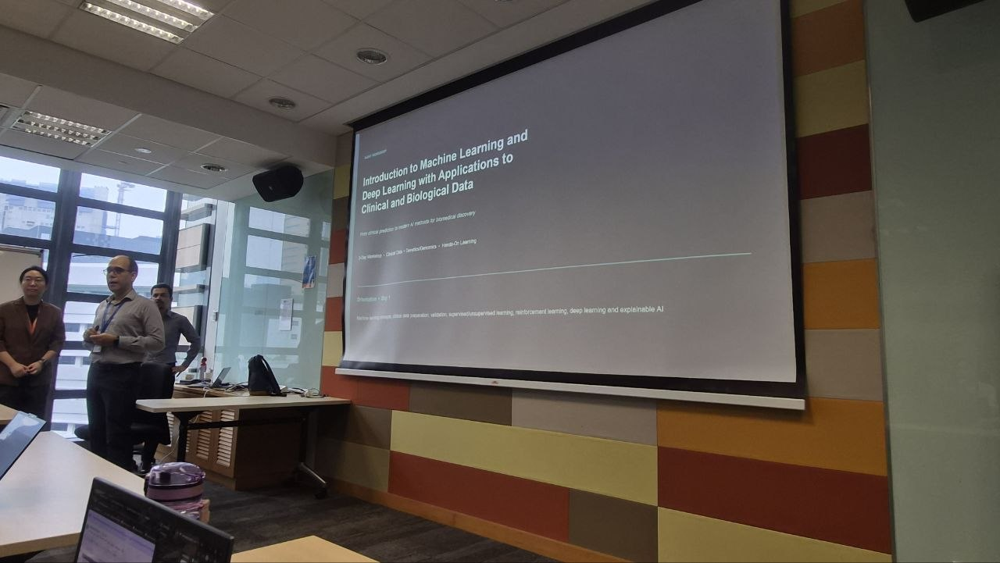
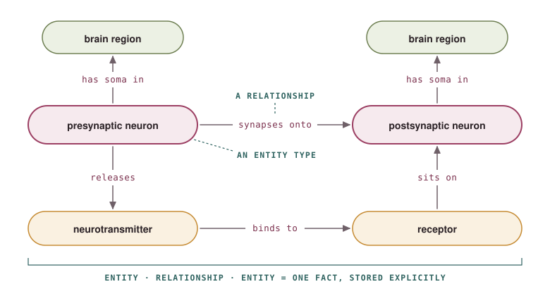
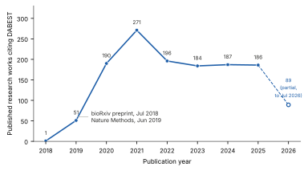

::: {.page-lead}
Thinking out loud, wherever my curiosity may wander.
:::

::::: {.card-grid}

:::: {.pcard}

::: {.pcard-body}
### [When Good Scores Lie](musings/machine-learning-course/index.qmd){.stretched-link}
[2026]{.paper-meta}

A machine learning course left me with more questions than answers, and this is my exploration of
the debates behind them.
:::

::::

:::: {.pcard}

::: {.pcard-body}
### [Inside the Black Box](musings/ai-bootcamp/index.qmd){.stretched-link}
[2026]{.paper-meta}

An exploration of the concepts that underpin modern AI, and why they felt unexpectedly familiar
from my perspective as a neuroscientist.
:::

::::

:::: {.pcard}

::: {.pcard-body}
### [Who uses DABEST?](https://acclab.github.io/DABEST-python/blog/posts/dabesties-over-the-years/dabesties-over-the-years.html){.stretched-link target="_blank" rel="noopener"}
[2026]{.paper-meta}

Who are the users of the 2019 version of DABEST? I take a deep dive into seven years of citing
papers to find out.
:::

::::

:::::
