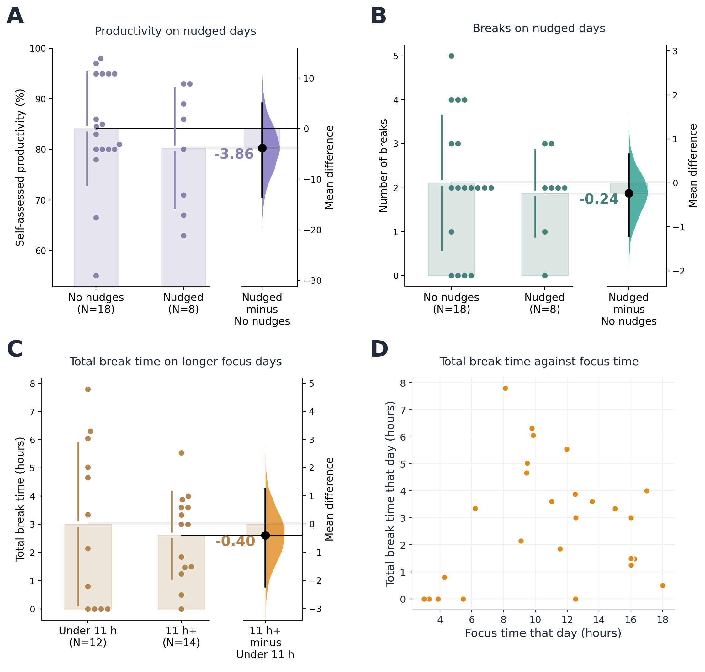
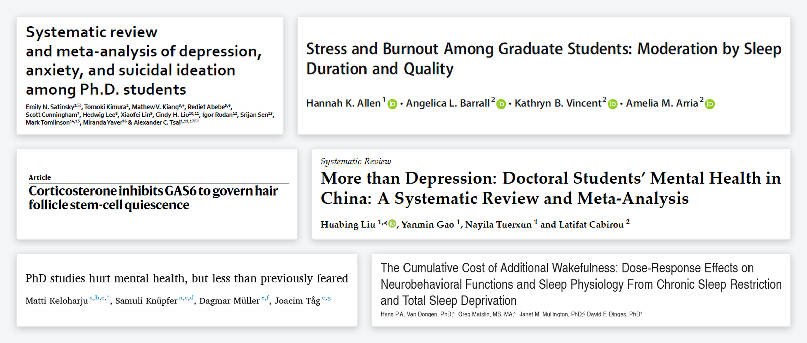

[← Back to my musings](../../musings.qmd){.back-link}

::: {.page-lead}
***The last weeks before my thesis defense, as logged by my own focus timer, and what they showed me about how I actually worked.***
:::

While writing my PhD thesis, I built [Focus Pocus](../../tools/focus-pocus/index.qmd), a small
desktop timer that nudged me when I drifted off. For every session, it logged when it ended, how
long I focused, how long I paused, how often it caught me wandering, and how productive I felt,
rated by me at the end. I spent my PhD observing and measuring flies. For these weeks, the
animal in the experiment was me.

This post is my take on the tool and the data it collected. The app was only fully working by
early February, so the logs ran from then until the day before my defense in March: 26 days of
records in all. That is one person and 26 days, so what follows is description, not
proof. Some of it still surprised me.

## 282 hours

{.paper-figure style="max-width:900px" fig-alt="A timeline from early February to the thesis defense. Purple bars above a central line show focus time per day, orange bars below show my self-assessed productivity. Points on the line mark the first full draft submitted to the committee, the mock defense with the lab and the thesis defense."}

[**Figure 1.** Total focus time per day (purple, above the line) and my self-assessed productivity
(orange, below the line). Points on the line mark the milestones: the first full draft submitted
to the committee, the mock defense with the lab and the thesis defense.]{.fig-legend style="max-width:900px"}

Those 26 days added up to 282 hours of focus, about 11 a day. That is not how long it took to
write my thesis. I only switched Focus Pocus on when I needed the discipline, for long, unbroken
stretches of writing where drifting off would have cost me. Everything around those stretches, and
the days I didn't need the help, went unlogged. So the 282 hours were the hardest hours, not all of
them.

The logs fell into two stretches. The first ran 16 days straight, weekends included, at about 10
focus hours a day, and ended when the full draft went to my committee. The second was preparing for
the defense, and it finished at full force: **15 to 18 hours of focus a day** in the last five
days, peaking at 18 the day before. My productivity ratings averaged 83%. Whether they tracked
the hours is a question for the estimation plots further down.

## Past midnight

{.paper-figure style="max-width:760px" fig-alt="An animation. It starts with one row per recorded day, each work session drawn as a bar across a 6am-to-6am axis, most running from late morning or early afternoon to 3 to 5am, with the last rows starting around 8am. The bars then break apart at each hour and stack into a 24-hour clock whose bars are longest from about 1pm to 1am and almost disappear between 6am and 9am."}

[**Figure 2.** When in the day I was working. Each row is one recorded day, with its sessions drawn
from 6am to 6am. The sessions then break apart at each hour and stack into a 24-hour clock, where
the length of each bar shows the share of recorded days on which I worked during that hour. The
outer circle is 100% of days.]{.fig-legend style="max-width:760px"}

I'm a night owl, and the clock agreed. I was still working past midnight on 24 of the 26 days, and
on 16 of them I didn't stop until somewhere between 3 and about 6am. Before the final week, the
timer usually started between 10am and 1pm.

One caveat on reading this clock: it shows when I pressed start, not when my day began. The end
times are accurate, because I always stopped the timer when I finished. But I often started working
before turning it on, around meals and getting ready, and some days I only remembered once my focus
was already slipping. So the mornings were less empty than the chart suggests.

The last five days were different, and on purpose. I was trying to shift my body clock closer to
the time my defense would start. The timer was running by 7 to 9:15am every day, earlier than on
any day before, yet I still stopped between 1:20 and 2:20am, and once not until 6am. The extra
hours came out of my sleep.

## Nudges, breaks and productivity

The app's whole premise was that catching yourself drifting helps. So, did nudged days feel less
productive, did breaks track the length of the day, and did long days feel better or worse?

{.paper-figure style="max-width:900px" fig-alt="Four panels. A: self-assessed productivity on days with and without nudges, with a mean difference of -3.86. B: number of breaks on days with and without nudges, with a mean difference of -0.24. C: total break time on days with under 11 hours versus 11 or more hours of focus, with a mean difference of -0.40 hours. D: a scatter plot of total break time against focus time, with no clear pattern."}

[**Figure 3.** Nudges, breaks and self-assessed productivity across the 26 recorded days. A to C
are estimation plots made with [DABEST](https://github.com/ACCLAB/DABEST-python). Left: each dot is
one day, and the height of the bars shows the group mean. Gapped lines show the mean ± SD. Right:
the mean difference between the two groups (black dot), with its 95% CI (black line) and bootstrap
distribution (curve). (A) Self-assessed productivity on days with no nudges (n = 18) versus days
with at least one nudge (n = 8). (B) Number of breaks on the same days. (C) Total break time on days
with under 11 hours (n = 12) versus 11 or more hours of focus (n = 14). (D) Total break time against
focus time for each day.]{.fig-legend style="max-width:900px"}

Nudges barely mattered. On nudged days I rated myself about 4 points lower (A: Hedges' g = −0.33,
95% CI −1.30 to 0.50), and the number of breaks barely changed (B: g = −0.16, 95% CI −0.90 to
0.53). Both intervals comfortably include zero.

The breaks were mostly meals or time online, and I expected longer days to need more of them. They
didn't. Days with 11 or more hours of focus had about 25 minutes less break time (C: g = −0.17, 95%
CI −1.01 to 0.68), and in D the points scatter with no clear trend: my **18-hour day had half an
hour of breaks**, while an 8-hour day had almost 8.

Productivity is where the clearest difference showed up. Using the same 11-hour split as panel C,
long days were rated about 9 points higher than shorter ones (87% versus 78%; mean difference +9.1,
95% CI +1.1 to +17.7; g = 0.84), and this is the only interval here that stays above zero. Days
with two or more breaks were also rated about 6 points higher than days with fewer (g = 0.49, 95%
CI −0.32 to 1.55), though that interval does include zero. So the long, steady days felt the best,
at least in the moment. Whether they really were is a different question.

## What [Focus Pocus](https://github.com/mnicolee/Focus-Pocus) can't see

Focus Pocus counted hours, not what they cost. A thesis asks for a particular kind of thinking:
holding years of experiments in your head at once and turning them into one argument, day after
day, with no real break from it. By the final weeks, other things were slipping. My stamina
dropped, since I had stopped exercising entirely, and I started forgetting things and losing hair.
One morning my whole body felt so tired and heavy that I couldn't will myself to work. Discipline
got me to the desk anyway. None of that is in the data.

{.paper-figure style="max-width:900px" fig-alt="Six title clippings from published papers on PhD students' mental health, stress hormones and hair growth, and sleep loss, arranged as paper cutouts on a light grey board."}

[**Figure 4.** A few of the papers behind this section, on PhD students' mental health and on what
stress and lost sleep do to the body and mind. Full references are listed below.]{.fig-legend style="max-width:900px"}

It is, however, in the literature. In a survey of 3,659 PhD students in Flanders, Belgium, 32%
were at risk of a common psychiatric disorder, most often depression^1^. A meta-analysis found
clinically significant depressive symptoms in about 24% of PhD students^2^. Swedish health records
give a lower number, about 7% receiving medication or a diagnosis for depression in a given year,
but still show that doctoral study takes a toll^3^. In Australia, impostor thoughts, perfectionism
and loneliness were strong predictors of depression and anxiety in PhD students^4^. Closer to home,
a review of 35 Chinese-language studies found doctoral students in China above population norms on
several symptom scales, most consistently interpersonal sensitivity, then depression and
somatization^5^. Even hair loss may have a mechanism: in mice, the stress hormone corticosterone
keeps hair follicle stem cells resting, so new hair stops growing^6^.

The biggest blind spot was sleep. I was barely sleeping through most of these weeks, logged or
not. In the final week alone, I usually stopped around 2am and was back at my desk by about 8am,
and showering and getting ready came out of that gap too. In a classic lab study, six hours a night
for two weeks left people as impaired as a full night without sleep on key attention and memory
tests, and they were largely unaware of it^7^. Among 2,683 graduate students, stress was less
strongly linked to exhaustion in those who slept longer and better^8^. Doctoral students also seem
especially prone to poor sleep: among 1,194 medical students in China, doctoral students had almost
twice the odds of poor sleep, by questionnaire, compared with other students^9^. And in a small
study of design students, irregular sleep was linked to lower creativity and attention, at least as
much as short sleep was^10^. So my ratings throughout may say as much about how tired I was as
about how well I was working.

## What I'd take from it

Focus Pocus was good at what it measured: when I stopped and how long I focused. Longer days did
tend to feel better, but hours only explained part of a good day, and the app's efficiency score,
which sat near 100% almost every day, explained none of it.

Next time, I would be more diligent about logging and record when each break happened, not just how
long it lasted. I would also have the timer start on its own when I opened the documents I was
working on, and line the logs up with the health data from my Garmin: sleep, heart rate, HRV and
stress.

From 3 January, when I set my experiments aside and started writing full time, to my defense was
66 days. For those 66 days, the thesis came before experiments, exercise and most of everyday life.
I shifted my body clock in time, and the defense went well ([I graduated!](https://claridgechang.com/news/posts/2026-07-15-nicole-lee-graduates/index.html)).
That said, this is not a recommendation. I still believe in good sleep and planning ahead. I had a
fixed deadline and not much time, and this was my best within it.

Thank you to my supervisor, Prof Adam Claridge-Chang, for always keeping his door open, and to my
TAC, the PhD admin team and my lab mates, who made the lab feel like a second home. To my parents,
my grandma, my godmother and my uncle: your dedication and endless warmth shaped who I am, and
this thesis is as much a result of your love as of my work. I'll carry it with me through every
chapter yet to come. And to my partner and my close friends: thank you for the encouragement, the
food when I forgot to eat, and for believing I could do this, even at 3am.

::: {.callout-note collapse="true"}
## Technical note

Focus Pocus saved one record per session with its end time, focus time, pause time, number of
pauses, number of nudges and my productivity rating. Start times are the end time minus focus and
pause time. A day runs from 6am to 6am SGT, so a session that starts at 2am counts toward the day
before, and sessions under five minutes are dropped. The data covers 4 February to 9 March 2026, 26
recorded days in all. Estimation plots and the productivity comparisons in the text use DABEST with
5,000 bootstrap resamples and bias-corrected and accelerated 95% CIs. Productivity per day is the
mean of that day's ratings.
:::

### References

1. Levecque, K., Anseel, F., De Beuckelaer, A., Van der Heyden, J. & Gisle, L. (2017). Work
   organization and mental health problems in PhD students. *Research Policy*, 46(4), 868–879.
   [doi:10.1016/j.respol.2017.02.008](https://doi.org/10.1016/j.respol.2017.02.008)
2. Satinsky, E. N., Kimura, T., Kiang, M. V., et al. (2021). Systematic review and meta-analysis
   of depression, anxiety, and suicidal ideation among Ph.D. students. *Scientific Reports*, 11,
   14370. [doi:10.1038/s41598-021-93687-7](https://doi.org/10.1038/s41598-021-93687-7)
3. Keloharju, M., Knüpfer, S., Müller, D. & Tåg, J. (2024). PhD studies hurt mental health, but
   less than previously feared. *Research Policy*, 53(8), 105078.
   [doi:10.1016/j.respol.2024.105078](https://doi.org/10.1016/j.respol.2024.105078)
4. Mills, L., Read, G. J. M., Bragg, J. E., Hutchinson, B. T. & Cox, J. A. (2024). A study into the
   mental health of PhD students in Australia: investigating the determinants of depression,
   anxiety, and suicidality. *Scientific Reports*, 14, 22636.
   [doi:10.1038/s41598-024-72661-z](https://doi.org/10.1038/s41598-024-72661-z)
5. Liu, H., Gao, Y., Tuerxun, N. & Cabirou, L. (2026). More than depression: doctoral students'
   mental health in China: a systematic review and meta-analysis. *Behavioral Sciences*, 16(8),
   1355. [doi:10.3390/bs16081355](https://doi.org/10.3390/bs16081355)
6. Choi, S., Zhang, B., Ma, S., et al. (2021). Corticosterone inhibits GAS6 to govern hair
   follicle stem-cell quiescence. *Nature*, 592, 428–432.
   [doi:10.1038/s41586-021-03417-2](https://doi.org/10.1038/s41586-021-03417-2)
7. Van Dongen, H. P. A., Maislin, G., Mullington, J. M. & Dinges, D. F. (2003). The cumulative
   cost of additional wakefulness: dose-response effects on neurobehavioral functions and sleep
   physiology from chronic sleep restriction and total sleep deprivation. *Sleep*, 26(2), 117–126.
   [doi:10.1093/sleep/26.2.117](https://doi.org/10.1093/sleep/26.2.117)
8. Allen, H. K., Barrall, A. L., Vincent, K. B. & Arria, A. M. (2021). Stress and burnout among
   graduate students: moderation by sleep duration and quality. *International Journal of
   Behavioral Medicine*, 28(1), 21–28.
   [doi:10.1007/s12529-020-09867-8](https://doi.org/10.1007/s12529-020-09867-8)
9. Liu, J., Hao, Q., Li, B., Zhang, R., Luo, G. & Sun, D. (2024). Prevalence and influencing
   factors of sleep disorders in medical students after the COVID-19 pandemic. *BMC Psychiatry*,
   24, 538. [doi:10.1186/s12888-024-05980-0](https://doi.org/10.1186/s12888-024-05980-0)
10. King, E., Daunis, M., Tami, C. & Scullin, M. K. (2017). Sleep in studio based courses: outcomes
    for creativity task performance. *Journal of Interior Design*, 42(4), 5–28.
    [doi:10.1111/joid.12104](https://doi.org/10.1111/joid.12104)

[]{.section-rule}
