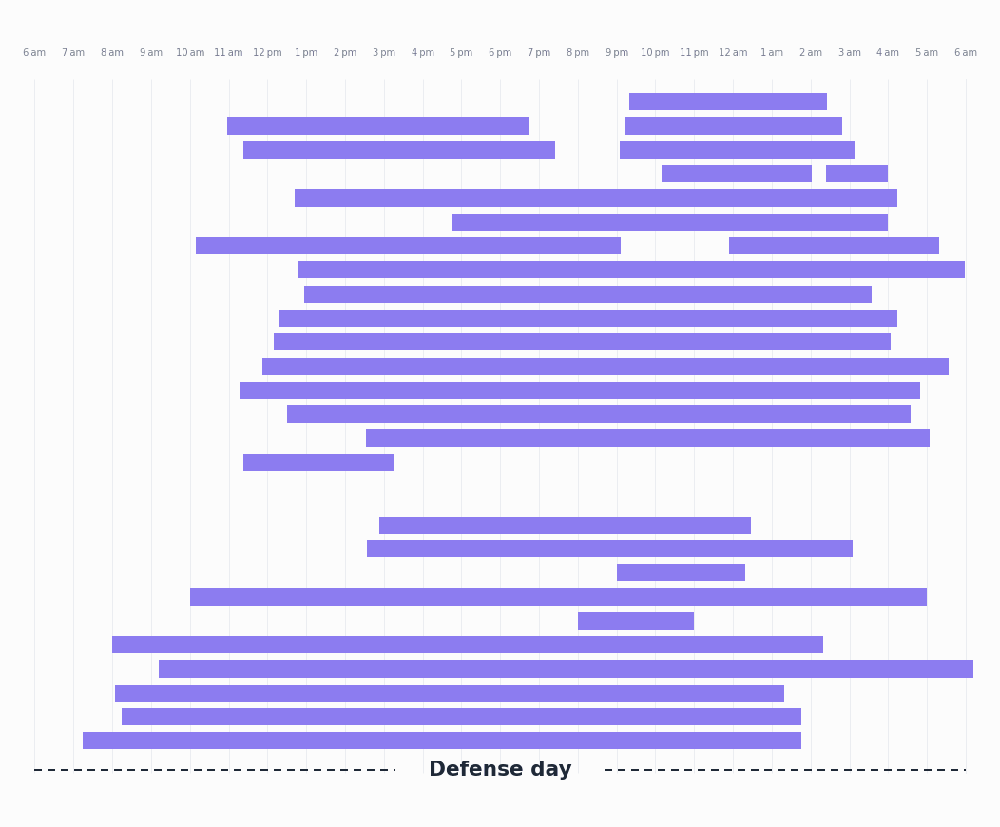

[← Back to my musings](../../musings.qmd){.back-link}

::: {.page-lead}
*The last weeks before my thesis defense, as logged by my own focus timer, and what they showed me about how I actually worked.*
:::

While writing my PhD thesis, I built [**Focus Pocus**](../../tools/focus-pocus/index.qmd), a small
desktop timer that nudged me when I drifted off. For every session, it logged when it ended, how
long I focused, how long I paused, how often it caught me wandering, and how productive I felt,
rated by me at the end. I spent my PhD observing and measuring flies, and for these weeks, the
animal in the experiment was me.

This post is my take on the Focus Pocus tool and the data it collected. The app was fully working only by
early February, so the logs ran from then until the day before my defense in March, which was 26 days of
records. 

## 282 hours

{.paper-figure style="max-width:900px" fig-alt="A timeline from early February to the thesis defense. Purple bars above a central line show focus time per day, orange bars below show my self-assessed productivity. Points on the line mark the first full draft submitted to the committee, the mock defense with the lab and the thesis defense."}

[**Figure 1.** Total focus time per day (purple, above the line) and my self-assessed productivity
(orange, below the line). Points on the line mark the milestones: the first full draft submitted
to the committee, the mock defense with the lab and the thesis defense.]{.fig-legend style="max-width:900px"}

Those 26 days added up to 282 hours of focus, about 11 focus hours a day. **This was not how long it took to
write my thesis per day**. In reality, I would only use Focus Pocus **when I needed the discipline, for long and unbroken
stretches** of writing where drifting off would have cost me. Days when I didn't need that help, or was in the lab doing experiments, went unlogged. So the 282 hours were the hardest hours for me during my thesis writing.

## Burning the midnight oil

{.paper-figure style="max-width:760px" fig-alt="An animation. It starts with one row per recorded day, each work session drawn as a bar across a 6am-to-6am axis, most running from late morning or early afternoon to 3 to 5am, with the last rows starting around 8am. The bars then break apart at each hour and stack into a 24-hour clock whose bars are longest from about 1pm to 1am and almost disappear between 6am and 9am."}

[**Figure 2.** When in the day I was working. Each row is one recorded day, with its sessions drawn
from 6am to 6am. The sessions then break apart at each hour and stack into a 24-hour clock, where
the length of each bar shows the share of recorded days on which I worked during that hour. The
outer circle is 100% of days.]{.fig-legend style="max-width:760px"}

The clock shows how late my days ran. I was often working past midnight on 24 of the 26 days, and
on 16 of them I didn't stop until somewhere between 3 and about 6am. That wasn't because I'm a
night owl. The work simply needed the hours, so even on days I woke up early, I still went to bed late.

**One point to note when reading this clock**: As mentioned before, Focus Pocus only records when I pressed start, not when my day began. 

## Nudges, breaks and productivity

The app's whole premise was that catching yourself drifting helps. So, did nudged days feel less
productive, did breaks track the length of the day, and did long days feel better or worse?

{.paper-figure style="max-width:900px" fig-alt="Four panels. A: self-assessed productivity on days with and without nudges, with a mean difference of -3.86. B: number of breaks on days with and without nudges, with a mean difference of -0.24. C: total break time on days with under 8 hours versus 8 or more hours of focus, with a mean difference of +2.73 hours. D: self-assessed productivity on days with under 8 hours versus 8 or more hours of focus, with a mean difference of +11.71."}

[**Figure 3.** Nudges, breaks and self-assessed productivity across the 26 recorded days. All four panels
are estimation plots made with [DABEST](https://github.com/ACCLAB/DABEST-python). Left: each dot is
one day, and the height of the bars shows the group mean. Gapped lines show the mean ± SD. Right:
the mean difference (Δ) between the two groups, with its 95% CI. (A) Self-assessed productivity on days with no nudges (n = 18) versus days
with at least one nudge (n = 8). (B) Number of breaks on the same days. (C) Total break time on days
with under 8 hours (n = 6) versus 8 or more hours of focus (n = 20). (D) Self-assessed productivity on
the same days as C.]{.fig-legend style="max-width:900px"}

Nudged days felt only slightly less productive, a small drop of about 4% compared with days without
nudges (Δ = −3.86; Hedges' g = −0.33, Cliff's δ = −0.20; Fig. 3A). Nudges also barely changed the number of
breaks I took (Δ = −0.24; Hedges' g = −0.16, Cliff's δ = −0.08; Fig. 3B).

A normal working day in Singapore is 8 hours^1^, so I used that to split my days into normal
(< 8 h) and long (≥ 8 h) ones. On long days, I took more breaks and had longer breaks in total (Δ = +2.73; Hedges' g = 1.37, Cliff's δ = 0.77;
Fig. 3C). Longer days also felt clearly more productive than normal ones to me (Δ = +11.71;
Hedges' g = 1.10, Cliff's δ = 0.52; Fig. 3D).

So, as expected, **the longer I worked, the more breaks I took, yet the more productive I felt.**
However, **all of this came at a cost.**

## The cost of those hours

**Focus Pocus counted hours, not what they cost.** A thesis asks for a particular kind of thinking:
holding years of experiments in your head at once and turning them into one argument, day after
day, with no real break from it. By the final weeks, **I could feel my health deteriorating.** My stamina
dropped drastically, since I had stopped exercising entirely and could barely walk 1000 steps without panting. I started experiencing memory lapses and had dramatic hair loss.
I can still vividly remember the morning when my whole body felt so tired and heavy that I physically struggled walking to the desk. **These were all experiences that would never be recorded in the data or in my thesis, but they will live forever in my memory.**

{.paper-figure style="max-width:900px" fig-alt="Six title clippings from published papers on PhD students' mental health, stress hormones and hair growth, and sleep loss, arranged as paper cutouts on a light grey board."}

[**Figure 4.** A few of the papers behind this section, on PhD students' mental health and on what
stress and lost sleep do to the body and mind. Full references are listed below.]{.fig-legend style="max-width:900px"}

**However, I was not the only doctoral student facing these challenges.** In a survey of 3,659 PhD students in Flanders, Belgium, 32%
were at risk of a common psychiatric disorder, most often depression^2^. A meta-analysis found
clinically significant depressive symptoms in about 24% of PhD students^3^. Swedish health records
give a lower number, about 7% receiving medication or a diagnosis for depression in a given year,
but still show that doctoral study takes a toll^4^. In Australia, impostor thoughts, perfectionism
and loneliness were strong predictors of depression and anxiety in PhD students^5^. Closer to home,
a review of 35 Chinese-language studies found doctoral students in China above population norms on
several symptom scales, most consistently interpersonal sensitivity, then depression and
somatization^6^. Even hair loss may have a mechanism: in mice, the stress hormone corticosterone
keeps hair follicle stem cells resting, so new hair stops growing^7^.

The biggest blind spot was sleep. **I was barely sleeping through most of these weeks (~4h to 6h at best), logged or
not**. In a classic lab study, six hours a night
for two weeks left people as impaired as a full night without sleep on key attention and memory
tests, and they were largely unaware of it^8^. Among 2,683 graduate students, stress was less
strongly linked to exhaustion in those who slept longer and better^9^. And when 28 interior design
undergraduates at Baylor University in Texas wore sleep-tracking wristbands for a week, those whose sleep
was short or varied a lot from night to night did worse on attention and creativity tests. The
researchers concluded that a regular sleep schedule matters at least as much as total sleep^10^.

So the hours in Figure 1 came with a cost the logs never saw, and judging by the research, **I was
far from alone in paying it**.

## What I'd take from it

Focus Pocus was good at what it was intended to do: **keeping me on track whenever I needed help**.
Longer days did tend to have better productivity, but **numbers never told the whole story**.

That productivity was also my own rating at the end of each session, so it's subjective. Whether I
was really productive, the data can't tell me. Some days I wrote ten pages of my thesis, and other
days, I only finished a single figure. On paper, the figure looked like less work, but it could take
round after round of analysis and redesign before it told the right story. Those days weren't
efficient, and some work can't be, but they still felt productive to me.

In the future, if I choose to continue developing the app, I would log more diligently and record when each break happened, not
just how long it lasted. The timer could also start on its own whenever I opened my thesis files, so
the logs no longer depended on me remembering to press start. Next would be linking the logs to my
watch's health data: sleep, heart rate, HRV and stress. I left that out only because my old watch
was too bulky to wear while typing. All that typing had also given me wrist tendonitis, so I chose
not to strain my wrist further.

From the time I halted major experiments to write my thesis until my defense day, I gave up
exercise and proper sleep, and lived with stress far above normal. The defense went splendidly well
([I graduated!](https://claridgechang.com/news/posts/2026-07-15-nicole-lee-graduates/index.html)),
but **this lifestyle is not a recommendation**. I still believe good sleep and enough rest are what
let you work and function properly, and it's what I'd tell anyone doing a PhD now or about to start
one.

Thank you to my supervisor, Prof Adam Claridge-Chang, and to my
TAC, the PhD admin team and my lab mates, who made the lab feel like a second home. To my parents and
my grandma: your dedication and endless warmth shaped who I am, and
this thesis is as much a result of your love as of my work. I'll carry it with me through every
chapter yet to come. And to my partner and close friends: thank you for the constant encouragement, the
food when I forgot to eat, and for believing I could do this, even at 3am.

## References

1. Ministry of Manpower, Singapore. Hours of work, overtime and rest days (accessed November 2026). [mom.gov.sg](https://www.mom.gov.sg/employment-practices/hours-of-work-overtime-and-rest-days)
2. Levecque, K. et al. (2017). Work organization and mental health problems in PhD students. *Research Policy* 46:868-879. [doi:10.1016/j.respol.2017.02.008](https://doi.org/10.1016/j.respol.2017.02.008)
3. Satinsky, E.N. et al. (2021). Systematic review and meta-analysis of depression, anxiety, and suicidal ideation among Ph.D. students. *Scientific Reports* 11:14370. [doi:10.1038/s41598-021-93687-7](https://doi.org/10.1038/s41598-021-93687-7)
4. Keloharju, M. et al. (2024). PhD studies hurt mental health, but less than previously feared. *Research Policy* 53:105078. [doi:10.1016/j.respol.2024.105078](https://doi.org/10.1016/j.respol.2024.105078)
5. Mills, L. et al. (2024). A study into the mental health of PhD students in Australia: investigating the determinants of depression, anxiety, and suicidality. *Scientific Reports* 14:22636. [doi:10.1038/s41598-024-72661-z](https://doi.org/10.1038/s41598-024-72661-z)
6. Liu, H. et al. (2026). More than depression: doctoral students' mental health in China: a systematic review and meta-analysis. *Behavioral Sciences* 16:1355. [doi:10.3390/bs16081355](https://doi.org/10.3390/bs16081355)
7. Choi, S. et al. (2021). Corticosterone inhibits GAS6 to govern hair follicle stem-cell quiescence. *Nature* 592:428-432. [doi:10.1038/s41586-021-03417-2](https://doi.org/10.1038/s41586-021-03417-2)
8. Van Dongen, H.P.A. et al. (2003). The cumulative cost of additional wakefulness: dose-response effects on neurobehavioral functions and sleep physiology from chronic sleep restriction and total sleep deprivation. *Sleep* 26:117-126. [doi:10.1093/sleep/26.2.117](https://doi.org/10.1093/sleep/26.2.117)
9. Allen, H.K. et al. (2021). Stress and burnout among graduate students: moderation by sleep duration and quality. *International Journal of Behavioral Medicine* 28:21-28. [doi:10.1007/s12529-020-09867-8](https://doi.org/10.1007/s12529-020-09867-8)
10. King, E. et al. (2017). Sleep in studio based courses: outcomes for creativity task performance. *Journal of Interior Design* 42:5-28. [doi:10.1111/joid.12104](https://doi.org/10.1111/joid.12104)

[]{.section-rule}
