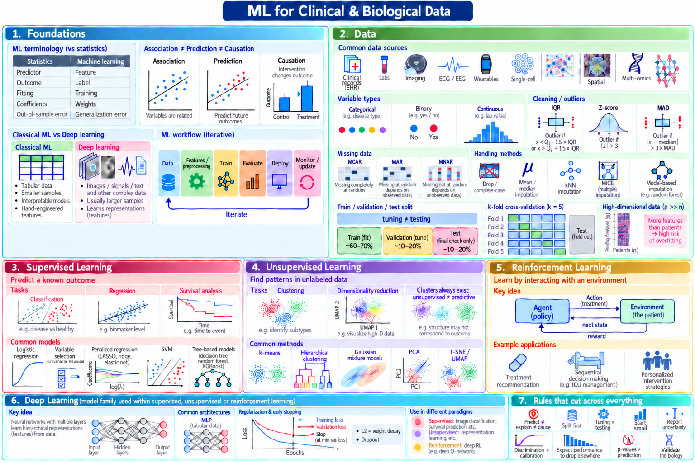
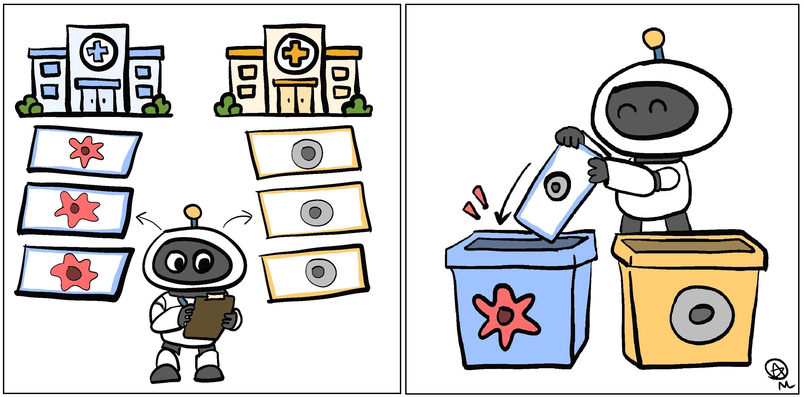
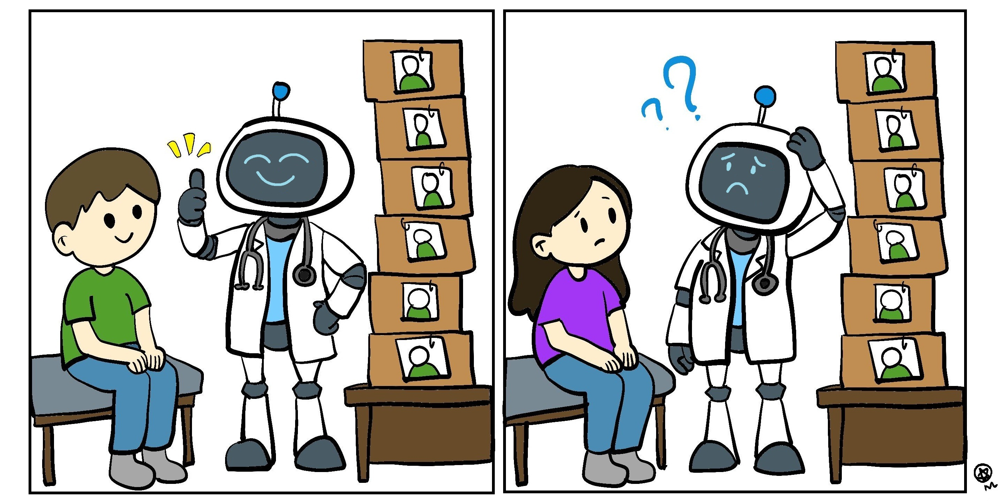
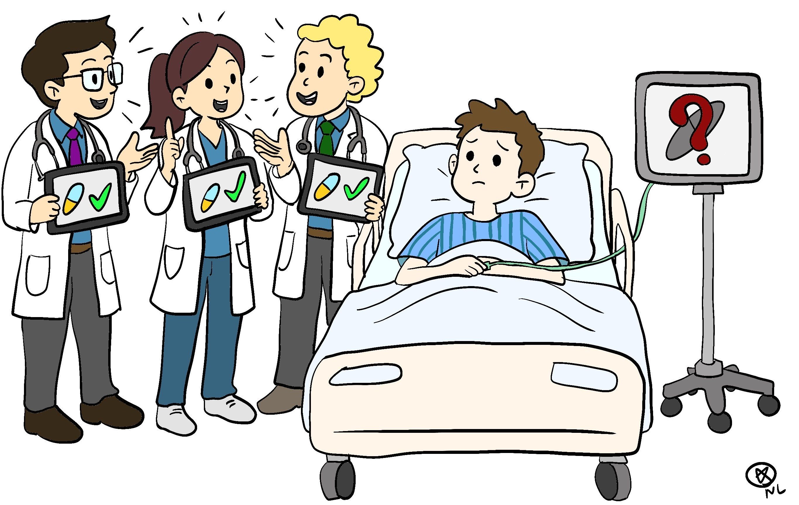

[← Back to my musings](../../musings.qmd){.back-link}

::: {.page-lead}
***Why a good score is where the questions start, not where they end.***
:::

On 28 and 29 September, I attended a two-day course at Duke-NUS on [*Introduction to Machine Learning and Deep Learning with Applications to Clinical and Biological Data*]{.underline}.

I had first learnt the basics of machine learning at the University of Washington and used some of it again in my PhD thesis, such as hierarchical clustering and PCA, but this course was a chance to revisit the foundations properly.

It covered everything from data preparation and model evaluation to supervised and unsupervised learning, reinforcement learning, deep learning and explainable AI, all in the context of clinical and biological data. I've tried to summarise the main ideas in the map below.

{style="display:block; max-width:1000px; width:100%; margin:1.6rem auto .6rem" fig-alt="A one-page map of the course in seven panels: foundations, data, supervised learning, unsupervised learning, reinforcement learning, deep learning, and rules that cut across everything, such as split first, start small and validate the biology."}

[**Figure 1.** A mind map of the course, from the foundations of machine learning and data preparation to supervised, unsupervised and reinforcement learning, deep learning, and the rules that cut across them all. Image generated with ChatGPT.]{.figure-credit style="max-width:1000px"}

A big thank you to the speakers, Prof Ehsan Saffari, Prof Bibhas Chakraborty, Prof Regina Hoo, Dr Yilin Ning and Dr John Ouyang, as well as the Duke-NUS AI + Medical Sciences Initiative (DAISI) and the Centre for Biomedical Data Science (CBDS) for organising the course.

What I found most interesting was that the course left me with more questions than answers about how machine learning should actually be used in science and medicine. I ended up reading more about some of the debates happening in the field now, and these are the four I dug into.

:::::: {.show .debates aria-roledescription="carousel" aria-label="Four debates"}
::::: {.slides}

```{=html}
<div class="show-nav">
<button class="nav-btn prev" type="button" aria-label="Previous debate"><svg viewBox="0 0 24 24" aria-hidden="true"><path d="M15 5l-7 7 7 7"/></svg></button>
<span class="counter" aria-live="polite">1 / 4</span>
<button class="nav-btn next" type="button" aria-label="Next debate"><svg viewBox="0 0 24 24" aria-hidden="true"><path d="M9 5l7 7-7 7"/></svg></button>
</div>
```

:::: {.slide .slide-stack .is-active}
### 1. Is more complex actually better?

{style="display:block; max-width:640px; width:100%; margin:0 auto .6rem" fig-alt="Cartoon of a race. A scientist drives a huge, smoking machine covered in gears and pipes, looking alarmed, while a smiling scientist on a simple bicycle crosses the checkered finish line level with it."}

[**Figure 2.** A bigger, more complicated model doesn't always finish ahead of a simple one. Cartoon drawn by me.]{.figure-credit style="max-width:640px"}

::: {.txt}
One message that came up repeatedly during the course was: **start simple**. A more complicated model is only useful if the added complexity actually improves how well it performs on unseen data. In one of the course examples, a random forest performed no better than logistic regression. The relationship in the data was already close to linear, and a single train/test split was not enough to conclude that one model was really better than the other.

There are striking examples of this in biology too. A 2025 *Nature Methods* study compared seven deep learning models for predicting how cells respond to genetic perturbations, including large foundation models such as scGPT and Geneformer. None outperformed a simple linear model ([Ahlmann-Eltze et al., 2025](https://doi.org/10.1038/s41592-025-02772-6)).

That does not mean complex models are pointless. TabPFN, for example, is pre-trained on millions of synthetic datasets and has shown that a more sophisticated approach can outperform well-tuned tree-based models on small tabular datasets, sometimes without any task-specific tuning ([Hollmann et al., 2025](https://doi.org/10.1038/s41586-024-08328-6)).

So perhaps the more useful question is not whether simple or complex models are better. It is, "**what does the extra complexity actually buy us?**"
:::
::::

:::: {.slide .slide-stack}
### 2. Did the model learn the biology, or the dataset?

{style="display:block; max-width:768px; width:100%; margin:0 auto .6rem" fig-alt="Two-panel cartoon. Left: a robot with a clipboard looks at tumour slides from a blue hospital and healthy slides from an orange hospital. Right: the robot happily drops a healthy slide with a blue border into the blue tumour bin."}

[**Figure 3.** The model learns which hospital a slide came from, not whether it shows a tumour. Cartoon drawn by me.]{.figure-credit style="max-width:768px"}

::: {.txt}
A 2026 study in *Nature Communications* tested 20 pathology foundation models ([Kömen et al., 2026](https://doi.org/10.1038/s41467-026-73923-2)). These are large models trained on huge collections of tissue images, which researchers then build on for tasks like tumour detection. The question was: what had these models actually learned?

For all 20 models, **the researchers could tell which medical centre most slides came from**, just from what the model had extracted from the image. This likely reflects differences in staining, scanners and slide preparation.

Why does that matter? Imagine a training set where most tumour slides come from Hospital A and most healthy slides from Hospital B. A tumour detector can take a shortcut: Hospital A means tumour. Show it a healthy slide from Hospital A, and it may call it a tumour.

To test this, the researchers built a simple tumour detector on top of each of the 20 models. They trained them on a public dataset of lymph node slides collected from several hospitals. They then gradually changed the training data so that hospital and diagnosis became more closely linked, and tested each detector on slides from hospitals it had not seen during training.

With balanced training data, accuracy was above 92%. When every tumour slide came from one set of hospitals and every healthy slide from another, accuracy fell to between 53% and 87%, depending on the model. In one case, a detector built on Virchow2, one of the most robust models in the study, classed a clearly cancerous patch as normal because of the hospital it came from.

**A model can score well without learning what you actually care about.**
:::
::::

:::: {.slide .slide-stack}
### 3. Can we still trust the test set?


{style="display:block; max-width:768px; width:100%; margin:0 auto .6rem" fig-alt="Two-panel cartoon. Left: a smiling robot doctor gives a thumbs up to a patient whose photo is in the stack of files beside it. Right: the same robot scratches its head, confused, in front of a new patient whose photo is not in the files."}

[**Figure 4.** Doing well on familiar patients doesn't mean much until a new one walks in. Cartoon drawn by me.]{.figure-credit style="max-width:768px"}

::: {.txt}
In machine learning, the test set is meant to be the final exam, data the model has never seen before. If information from it leaks into training, even indirectly, the score can look much better than the model really is and hide problems such as overfitting. That was why the course stressed splitting the data early and leaving the test set alone until the end.

It sounds obvious, but **leakage is surprisingly common**. A Princeton-led review found examples across 17 scientific fields, affecting 294 published papers ([Kapoor & Narayanan, 2023](https://doi.org/10.1016/j.patter.2023.100804)). A 2026 review of chronic kidney disease prediction studies, which has not yet been peer-reviewed, found a similar pattern: studies with high leakage reported about 95% accuracy on average, compared with about 80% in studies judged to be leakage-free ([Hossain et al., 2026](https://arxiv.org/abs/2607.11963)).

With large language models (LLMs), the problem gets harder because we often do not know exactly what was in the training data. Popular medical questions, case reports and benchmarks may already have appeared during pre-training. In one 2026 pilot analysis, GPT-5 scored nearly 10 percentage points lower on clinical cases published after its knowledge cutoff than on older cases ([Wang et al., 2026](https://arxiv.org/abs/2602.16747)). That does not mean the older cases were necessarily memorised, but it does make those benchmark scores harder to interpret.

So can we still trust the test set? Only as far as we can be sure the model has never seen it. With today's large models, that is getting harder to guarantee, which makes **testing on genuinely new data more important than ever**. That means new patients, new hospitals, or cases collected after the model was trained.
:::
::::

:::: {.slide .slide-stack}
### 4. Does a good prediction lead to a better decision?


{style="display:block; max-width:640px; width:100%; margin:0 auto .6rem" fig-alt="Cartoon of three cheerful doctors each holding a tablet showing a pill and a green tick, while the patient in the hospital bed beside them looks worried and the monitor shows a question mark."}

[**Figure 5.** Better decisions on paper don't always mean a better outcome for the patient. Cartoon drawn by me.]{.figure-credit style="max-width:640px"}

::: {.txt}
Much of the course was about prediction: will this patient develop an illness, and which subtype is it? Reinforcement learning asks a different question: which action leads to the best outcome over time, such as which treatment to try next. **A model that predicts well does not necessarily tell us what to do.**

Two 2026 studies in *Nature Medicine* show where this gap appears. In a randomised trial across 16 primary-care clinics in Kenya, an AI assistant built into patient records improved the quality of care ([Agweyu et al., 2026](https://doi.org/10.1038/s41591-026-04503-6)). Clinicians were more likely to make an appropriate diagnosis, choose an appropriate treatment and keep complete notes. But patients were no less likely to need further treatment two weeks later. Better decisions on paper did not clearly lead to better outcomes for patients.

The second study, in an emergency department, found a different problem ([Leibovitch et al., 2026](https://doi.org/10.1038/s41591-026-04601-5)). Expert reviewers rated 99 of 100 sampled AI recommendations as clinically appropriate. Yet as shifts got busier, clinicians used the system less, with use falling from 68% to 30%. **A good recommendation does not help if nobody uses it.**

So there are several steps between a good model and a better outcome. The prediction has to support the right decision, the clinician has to use it, and the action has to benefit the patient. The real test of a model is not how well it predicts, but whether using it improves outcomes where the decisions are actually made.
:::
::::

:::::
::::::

## Final thoughts

Machine learning is becoming easier to use almost by the day. Training a model can now take only a few lines of code, and AI tools can increasingly do much of the setup for us. The harder part is knowing **what to use**, **when to use it**, and **how much confidence to place in the result**.

Looking back, the four debates were less about building the most advanced model and more about using models carefully. Sometimes a simpler model is enough. Sometimes a model performs well for the wrong reason. Sometimes the test itself is misleading. And sometimes a good prediction still does not lead to a better decision.

That is probably the main thing I am taking away from the course. As machine learning becomes more common in research and medicine, knowing the newest model may matter less than knowing when a model is actually useful. For my own work, I want machine learning to be something I use because it answers the question well, not simply because it is there.

## References

Agweyu, A. et al. (2026). Generative AI-enabled clinical decision support system in primary care: a pragmatic, cluster-randomized trial. *Nature Medicine* 32:3032-3039.

Ahlmann-Eltze, C. et al. (2025). Deep-learning-based gene perturbation effect prediction does not yet outperform simple linear baselines. *Nature Methods* 22:1657-1661.

Hollmann, N. et al. (2025). Accurate predictions on small data with a tabular foundation model. *Nature* 637:319-326.

Hossain, M. et al. (2026). Evaluating reliability in machine learning models for early chronic kidney disease prediction: a systematic review of data leakage and predictor stability. *arXiv* 2607.11963 (preprint).

Kapoor, S. & Narayanan, A. (2023). Leakage and the reproducibility crisis in machine-learning-based science. *Patterns* 4:100804.

Kömen, J. et al. (2026). Towards robust foundation models for digital pathology. *Nature Communications* 17:5218.

Leibovitch, L. et al. (2026). Prospective evaluation of a large language model clinical decision support system in the emergency department. *Nature Medicine* 32:3741-3747.

Wang, X. et al. (2026). LiveClin: a live clinical benchmark without leakage. *International Conference on Learning Representations (ICLR)*.

```{=html}
<script>
document.querySelectorAll('.show').forEach(function (show) {
  var slides = show.querySelectorAll('.slide'), counter = show.querySelector('.counter'), n = slides.length, i = 0;
  var reduce = window.matchMedia('(prefers-reduced-motion: reduce)').matches;
  var timer = null, stopped = reduce;
  function play() { if (!stopped && !timer) timer = setInterval(function () { go(i + 1); }, 8000); }
  function pause() { clearInterval(timer); timer = null; }
  var dots = document.createElement('div');
  dots.className = 'dots';
  slides.forEach(function (s, j) {
    var b = document.createElement('button');
    b.type = 'button';
    b.setAttribute('aria-label', 'Go to debate ' + (j + 1));
    b.addEventListener('click', function () { step(j - i); });
    dots.appendChild(b);
  });
  show.querySelector('.slides').appendChild(dots);
  function go(k) {
    i = (k + n) % n;
    slides.forEach(function (s, j) { s.classList.toggle('is-active', j === i); dots.children[j].classList.toggle('is-active', j === i); });
    counter.textContent = (i + 1) + ' / ' + n;
  }
  function step(d) {
    go(i + d);
    if (show.getBoundingClientRect().top < 0) show.scrollIntoView({ behavior: 'smooth' });
  }
  go(0);
  play();
  show.addEventListener('click', function () { stopped = true; pause(); });
  show.addEventListener('mouseenter', pause);
  show.addEventListener('mouseleave', play);
  show.querySelector('.prev').addEventListener('click', function () { step(-1); });
  show.querySelector('.next').addEventListener('click', function () { step(1); });
  var x0 = null, y0 = null;
  show.addEventListener('touchstart', function (e) { x0 = e.touches[0].clientX; y0 = e.touches[0].clientY; }, { passive: true });
  show.addEventListener('touchend', function (e) {
    if (x0 === null) return;
    var dx = e.changedTouches[0].clientX - x0, dy = e.changedTouches[0].clientY - y0;
    if (Math.abs(dx) > 40 && Math.abs(dx) > Math.abs(dy)) { stopped = true; pause(); step(dx < 0 ? 1 : -1); }
    x0 = null;
  }, { passive: true });
});
</script>
```
