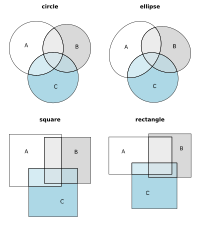
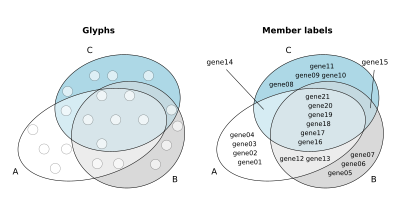
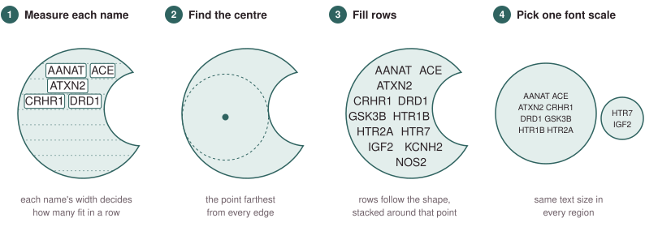
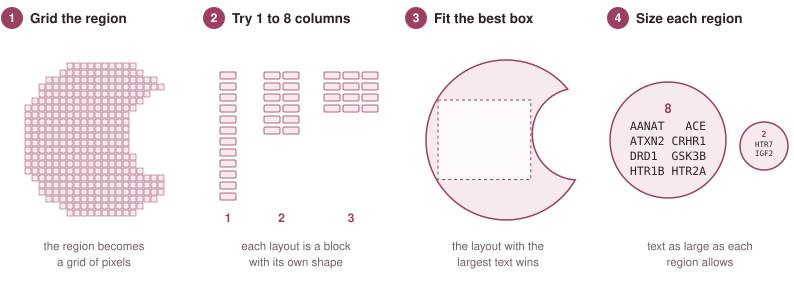
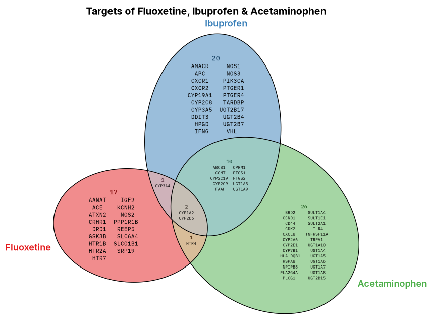
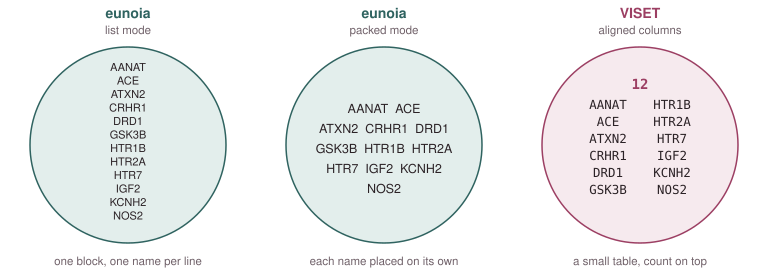

[← Back to research](../../research.qmd){.back-link}

[Rust library with Python, R, Julia and JavaScript packages · open source · contributor]{.paper-meta}

> **Abstract:** *Area-proportional diagrams show set sizes through the areas of their regions, but many combinations of intersections cannot be represented exactly by simple shapes. We present Eunoia, a Rust library that fits Euler diagrams and builds canonical Venn diagrams with four shape families: circles, ellipses, squares, and rectangles. It calculates region areas analytically, combines several initialization and optimization strategies, and reports diagnostics to assess the resulting fit. Plotting tools handle region polygons, labels, unit glyphs, and member names. Packages for Julia, Python, R, and JavaScript share the Rust implementation, as do a C interface and a web application that runs locally in the browser using WebAssembly.*

While building [VISET](../../tools/viset/index.qmd), I reached out to [Johan Larsson](https://jolars.co/), the creator of [**eunoia**](https://github.com/jolars/eunoia), the package I was using to draw my set diagrams. VISET could already print the actual genes inside each region, so I asked if eunoia could do that too. Johan is a statistician, and I was hoping to get some ideas from him on how to better develop itemization in set diagrams. I already had a rough version working in VISET to show him, and he was happy to collaborate, which turned into a wonderful opportunity to **work on itemization together**.

## So how does eunoia work?

Eunoia draws **area-proportional Euler and Venn diagrams**. It tries to make each region reflect the number of items it holds, as closely as the shapes allow. With three or more sets, it can get more challenging to find an exact fit, especially with circles and squares. There are more region sizes to match than there are ways to move and resize the shapes, so some regions have to give a little. Eunoia finds the closest layout it can and tells you how close it got. Ellipses and rotated rectangles can tilt to fit the overlaps, but as you add more sets, it gets harder to read the members inside each shape and overlap. Thus, I'd recommend [VISET's UpSet plot](../../tools/viset/index.qmd) if you have more than three sets to draw. Johan wrote the core in Rust, so eunoia works in many languages: Python, R, Julia and JavaScript, and there's also the [web app](https://eunoia.bz/), which makes it really accessible whether you code every day or not at all. For a more detailed look at eunoia and its pipelines, see [Johan's blog post](https://jolars.co/blog/2026-07-04-eunoia/).

{.paper-figure style="max-width:560px" fig-alt="The same three sets fitted with circles, ellipses, squares and rectangles"}

[The same three sets fitted with four different shapes. Figure from [Larsson & Lee, submitted to JOSS](https://github.com/openjournals/joss-reviews/issues/11506).]{.fig-legend style="max-width:560px"}

## How itemization works in eunoia

The size of a region gives you a rough idea of how many items it holds. Glyphs make that count clearer, with one dot for each item. Member names show you **which items they are**.

{.paper-figure style="max-width:760px" fig-alt="A three-set Euler diagram drawn twice, with one dot per item on the left and member names on the right"}

[The same diagram with glyphs (left) and member names (right). Figure from [Larsson & Lee, submitted to JOSS](https://github.com/openjournals/joss-reviews/issues/11506).]{.fig-legend style="max-width:760px"}

In Python, **eunoia can print those names in list or packed mode**. List mode puts them in one block, one name per line. In packed mode, eunoia measures each name separately and finds the point farthest from the region's edges. It then builds rows around that point, following the shape of the region. The text will not grow beyond the font size you set, and the same scale is used across the diagram.

{.paper-figure style="max-width:800px" fig-alt="Four steps of eunoia itemization: measure each name as its own box, find the point farthest from the region edges, fill rows that follow the shape around that point, and use one font scale for every region"}

[How eunoia packs names in a static figure. Schematic based on the eunoia source code, with example genes from the [DGIdb_Drug_Targets_2024 library in Enrichr](https://maayanlab.cloud/Enrichr/#libraries).]{.fig-legend style="max-width:800px"}

In the interactive version, you can hover over a region to see its name, count and members. How the tooltip lays things out depends on how tall and wide the figure is. Short lists stay in one column, while longer ones wrap into more columns. The text also shrinks when space is tight.

```{=html}
<iframe src="eunoia-interactive.html" title="Interactive eunoia Euler diagram of drug-target genes for Fluoxetine, Ibuprofen and Acetaminophen" loading="lazy" style="display:block; width:100%; max-width:760px; height:580px; margin:1.4rem auto .5rem; border:1px solid #E3E7EA; border-radius:8px; background:#fff"></iframe>
```

[Drug-target gene sets for Fluoxetine, Ibuprofen and Acetaminophen, drawn with eunoia as an interactive Plotly diagram. Hover over a region to see its members. Gene sets from the [DGIdb_Drug_Targets_2024 library in Enrichr](https://maayanlab.cloud/Enrichr/#libraries).]{.fig-legend style="max-width:760px"}

## How itemization worked in VISET

VISET handles the names differently. For each curved region, it tries between one and eight columns and finds the rectangle that allows the largest text. It uses a monospace font, with the count at the top, so the names line up like a small table. **Each region chooses its own text size**, so the font can vary across the diagram.

{.paper-figure style="max-width:800px" fig-alt="Four steps of VISET itemization: turn the region into a pixel grid, try one to eight columns, fit the box inside the region that allows the largest text, and choose the largest text size for each region separately"}

[How VISET places names in a curved region. Schematic based on the VISET source code, with the same example genes.]{.fig-legend style="max-width:800px"}

{.paper-figure style="max-width:760px" fig-alt="A VISET area-proportional Venn diagram of the drug-target genes for Fluoxetine, Ibuprofen and Acetaminophen, with every gene name printed inside its region"}

[Three drug-target gene sets drawn with VISET. Each region sets its own text size, so the font varies
across the diagram. Gene sets from the [DGIdb_Drug_Targets_2024 library in Enrichr](https://maayanlab.cloud/Enrichr/#libraries).]{.fig-legend style="max-width:760px"}

{.paper-figure style="max-width:768px" fig-alt="The same twelve members printed inside a circle three ways: eunoia list mode as one block with one name per line, eunoia packed mode with each name placed separately in rows, and VISET as two aligned columns with the count on top"}

[The same members printed three ways. Schematic with example genes from the [DGIdb_Drug_Targets_2024 library in Enrichr](https://maayanlab.cloud/Enrichr/#libraries).]{.fig-legend style="max-width:768px"}

I still love how tidy VISET's columns are and how easy they are to scan. But a rectangle can't use all the space in a curved region. Eunoia packs the names along each region's own outline and keeps the text consistent across the diagram.

Johan designed and wrote the engine behind eunoia, with every part of the pipeline carefully considered. I also contributed to eunoia's Python codebase and diligently tested it with different types of datasets. This collaboration was eye-opening and completely outside my usual work, and I learned a lot from it. I started out just using his package to create area-proportional layouts, but I had the good fortune to work on it with him. I'm so grateful to Johan for being so open to that. It's been an honor to be part of eunoia, and I can't wait to see where it goes next!

**Read the preprint here:** [arXiv:2611.02198](https://arxiv.org/abs/2611.02198)

**Use it here:** the [web app](https://eunoia.bz/), or on GitHub as
[eunoia](https://github.com/jolars/eunoia) and [eunoia-py](https://github.com/jolars/eunoia-py).

[]{.section-rule}
