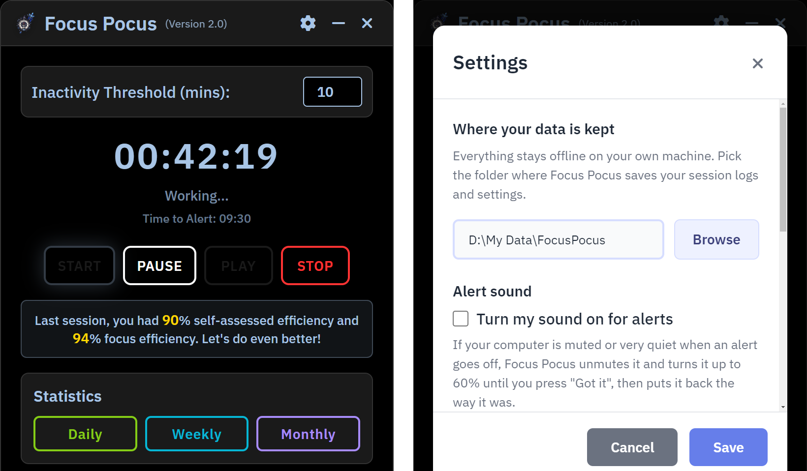
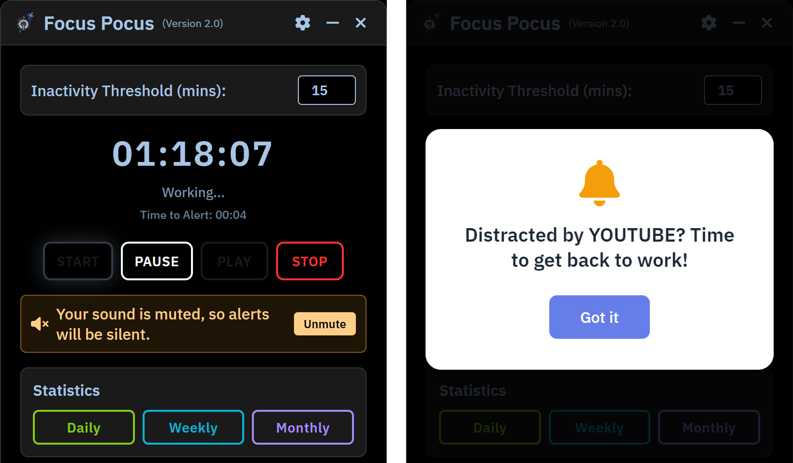
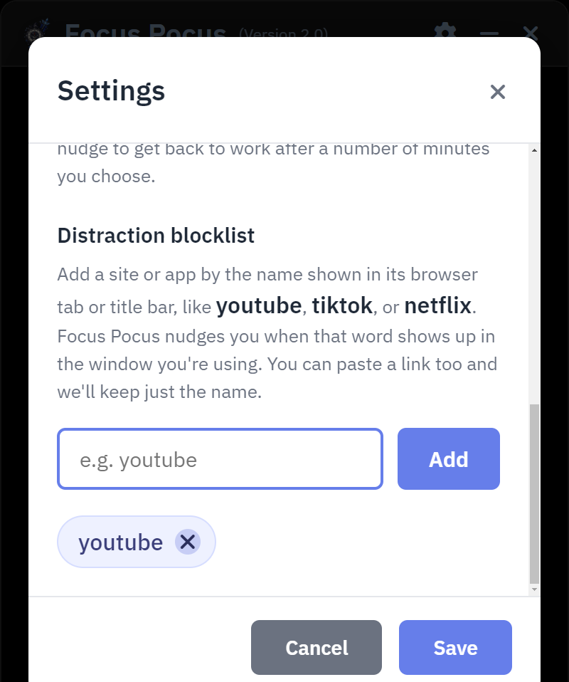
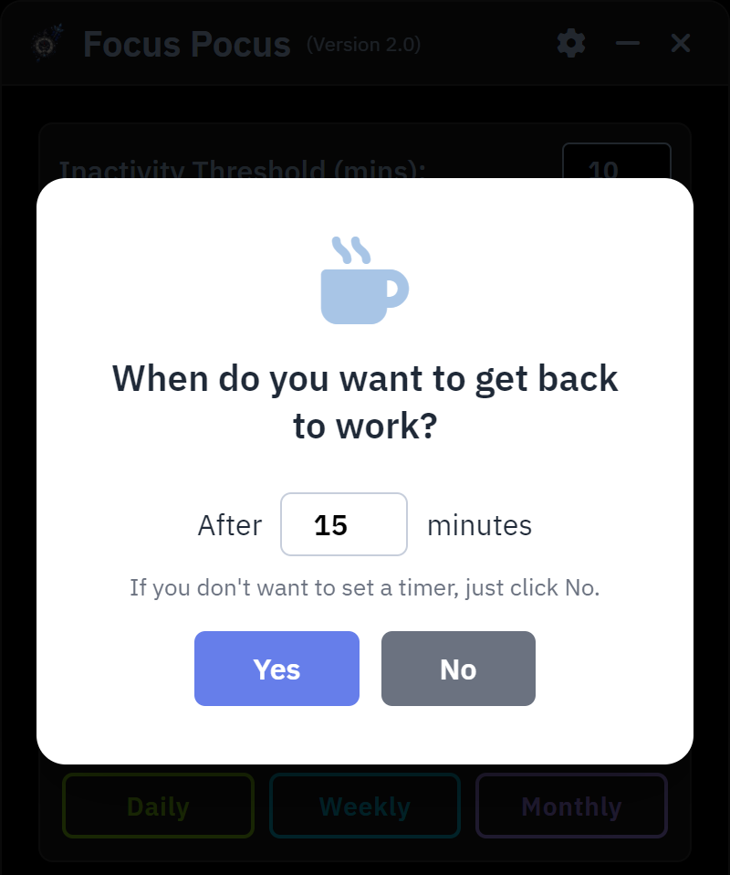
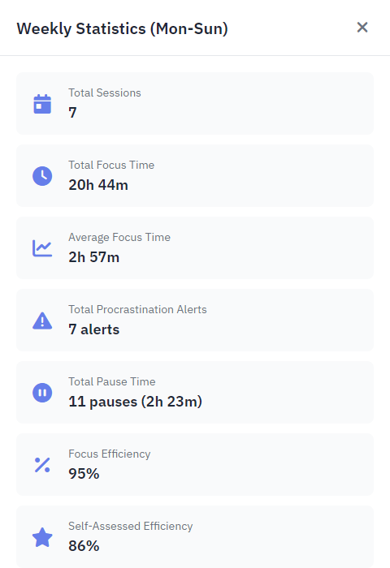

[← Back to tools](../../tools.qmd){.back-link}

[Productivity app · 2026]{.paper-meta}

When I started writing my PhD thesis, I found it **hard to stay focused**. Writing was mentally
draining, and because the work was so long and repetitive, my brain kept reaching for quick
rewards like surfing the web. An hour could slip by before I noticed, so I wanted something that would
catch me drifting and pull me back.

I also wanted to try **vibe coding**, which was still quite new at the time, just to see what
I could make and whether it could be something useful to me. So in January 2026, I started
Focus Pocus. There are already focus apps out there, like [Forest](https://www.forestapp.cc/),
[Freedom](https://freedom.to/), and [Cold Turkey](https://getcoldturkey.com/). But I wanted to
build one, try it out for myself, and **keep my data on my own computer**, because I think people
should be in charge of their own data.

::: {style="text-align:center; font-style:italic; font-size:calc(1em + 2px); margin:1.4rem 0; color:var(--ink-soft, #464C51)"}
"**Focus Pocus** is a small desktop app that runs in the background while you work, notices when
you drift, and nudges you back."
:::

It has a timer like a Pomodoro app, but it also keeps an eye out for when you've **gone idle or
wandered onto a distracting site**, and speaks up when you have.

{.paper-figure style="max-width:620px" fig-alt="Two Focus Pocus windows side by side. Left: the main window during a session, with a 00:42:19 timer, Working status, Time to Alert 09:30, START/PAUSE/PLAY/STOP buttons, a note that the last session had 90% self-assessed and 94% focus efficiency, and Daily/Weekly/Monthly stats buttons. Right: the settings panel open at Where your data is kept, with the folder D:\My Data\FocusPocus and a Browse button"}

[**Figure 1.** Left: the main window during a session, with the timer, a countdown to the next
nudge and a note on how the last session went. Right: the settings, where you choose the folder
Focus Pocus saves your data to.]{.fig-legend style="max-width:620px"}

## The nudge and the escalating beep

You set an **inactivity threshold**, say ten minutes, and if your mouse and keyboard stay quiet for
longer than that, Focus Pocus pops up and beeps. A site on your blocklist sets off the same nudge after
15 seconds in front of you. It keeps beeping every five seconds until you press "Got it", and **each beep is louder than the
last**, from 30% up to full volume.

Of course, you need to be unmuted to hear any of this. Focus Pocus **checks your sound** when it
opens and again about five seconds before a nudge. If you're muted or the volume is very low, a
banner tells you, with a button to turn your sound back on. You can also turn on a setting that
switches your sound on for alerts, and once you respond it puts the volume back where it was.

{.paper-figure style="max-width:620px" fig-alt="Two Focus Pocus windows side by side. Left: a session at 01:18:07 with a 15-minute threshold, four seconds before an alert, and an orange banner saying the sound is muted with an Unmute button. Right: an alert card with a bell reading Distracted by YOUTUBE? Time to get back to work! and a Got it button"}

[**Figure 2.** Left: the computer is muted, so a banner warns that alerts will be silent. Right:
the nudge you get after drifting onto YouTube.]{.fig-legend style="max-width:620px"}

## Bring your own distractions

Everyone has their own rabbit holes, so you build your own **blocklist**. In the settings, you add
the name you'd see on a site's browser tab or an app's title bar: `youtube`, `tiktok`, `netflix`,
a comfort game, a manga reader. Focus Pocus then looks for those words in whichever window is in
front and nudges you after 15 seconds on one, while the list itself lives in a plain file on your
computer.

{.paper-figure style="max-width:340px" fig-alt="The Focus Pocus settings panel open at the Distraction blocklist section, with a text box, an Add button and youtube already on the list"}

[**Figure 3.** The blocklist in the settings, with YouTube already added.]{.fig-legend
style="max-width:340px"}

Of course, the blocklist can't stop you, since you can always close the app, rename a tab, or find
another way around it. I made it to keep myself honest, so how strictly you use it is up to you.

## Breaks on your terms

I didn't want to force a set break time on anyone, because when you take a break depends on your
own schedule. You might want a buzz after ten minutes to get back to it, or no reminder at all
because you're doing chores away from your computer, so the **break reminder is optional and off
by default**.

If you turn it on in the settings, Focus Pocus asks each time you press pause whether you'd like
a reminder, and after how many minutes. When the time is up, Focus Pocus beeps just like a nudge, getting louder until you
press "Got it". The **timer stays paused until you press play**, so you can finish what you're doing
first.

{.paper-figure style="max-width:340px" fig-alt="A Focus Pocus dialog with a coffee cup icon asking When do you want to get back to work? After 15 minutes, a gray note saying If you don't want to set a timer, just click No, and Yes and No buttons"}

[**Figure 4.** With the break reminder on, Focus Pocus asks when you want to get back to work
each time you press pause.]{.fig-legend style="max-width:340px"}

## Your data never leaves your machine

Keeping your data private is the part I care about most, so Focus Pocus doesn't capture your
screen or save what you were looking at:

- **Idleness** comes from your operating system's idle timer, which only knows whether the mouse
  or keyboard has moved recently, and it's read in the moment and never saved.
- **Distractions** are spotted from the title of the window in front of you. Focus Pocus never
  reads the page itself or takes a screenshot, and the title isn't saved either.
- **Sound** is only checked for whether it's muted and how loud it is, at the two moments above.
- **Privacy**: the only session data saved is your focus time, your breaks, the number of nudges,
  and how productive you felt, from 0% to 100%, all kept in a plain file on your computer.
  Nothing is sent to the cloud or GitHub, so your data stays yours.

## What it tells you afterward

When you stop a session, you **rate how it went**. The Daily, Weekly, and Monthly buttons then add
everything up: total and average focus time, nudges, breaks, and two **efficiency scores**, one
measured by the app and one from your own ratings. Seeing them side by side shows how your own
sense of a session compares with what the app measured.

{.paper-figure style="max-width:360px" fig-alt="The Focus Pocus weekly statistics window: 7 sessions, 20h 44m total focus, 2h 57m average, 7 procrastination alerts, 11 pauses totaling 2h 23m, 95% focus efficiency and 86% self-assessed efficiency"}

[**Figure 5.** The weekly statistics, filled with the made-up sample sessions that come with the
code. Focus efficiency counts each nudge as ten lost minutes. Self-assessed efficiency is the
average of your ratings.]{.fig-legend style="max-width:360px"}

## Closing the chapter

**Focus Pocus wasn't built to do your work for you.** It caught me drifting plenty of times, and
that really helped bring me back to my thesis, which I finished and successfully defended. Now
that it has done what I needed, it's time to close the chapter on what started as a fun, simple
vibe-coded project. Development stops here, unless a bigger project brings me back to it or other people
are interested.

[View the code on GitHub →](https://github.com/mnicolee/Focus-Pocus){.read-more}

[]{.section-rule}
