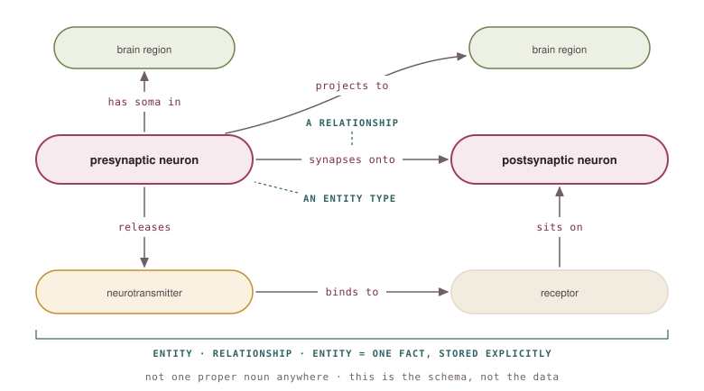
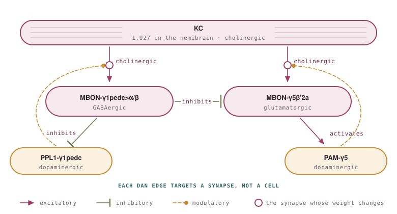
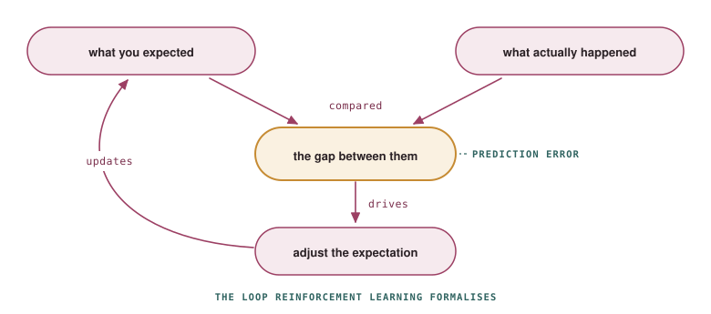

[← Back to writing](../../writing.qmd){.back-link}

::: {.page-lead}
***A beginner's attempt to make sense of AI, and the surprising places it led.***
:::

Last month I spent four days at the AI Boot Camp hosted by Duke-NUS Medical School and the Tianqiao
and Chrissy Chen Institute, alongside other researchers.

Before the course, I knew how to use AI tools, but that was about the extent of it. My questions were the ones you ask when you've never looked under the hood. Why does a model give me a different answer each time I ask the same thing? What actually happens between typing a prompt and getting a reply?

By the end of the week, I had answers to both, and a much clearer mental model of how these systems actually work. A large language model is only one part of the pipeline, and much of what shapes a response is determined by the information, context and tools around it.

What has stayed with me most, though, is how often something I already knew from neuroscience turned up in AI **with a name, a formal definition, and a body of research behind it.**

## Both questions have the same answer

The answer to my first question was surprisingly simple. A language model doesn't retrieve a stored answer; it generates one from scratch, one **token** at a time. Because there's a little randomness in how each next token is chosen, the same prompt won't always produce the same response.

The second question turned out to be much more interesting. I'd always imagined the model was the system. In reality, it's just one stage in a much larger pipeline. Before it runs, information may be retrieved, instructions assembled and context prepared. Afterwards, its output can be checked, sent to external tools, or even fed back into another round of reasoning. Once I saw where retrieval, agents and the rest actually fit, they stopped feeling like disconnected buzzwords and started making sense as different ways of building around the same underlying model.

More importantly, it changed how I think about using AI. Instead of endlessly rewording prompts, I now find myself asking whether the model has the information it needs in the first place, or whether the task really calls for something beyond the model alone.

## The unexpected connection

Knowledge graphs were one of many topics we covered, but they were the one that stayed with me. While a language model learns patterns from vast amounts of text, a **knowledge graph** stores information explicitly as **entities** and the **relationships** between them. That makes it possible to organise information from different sources, keep it up to date, and answer questions by following those relationships instead of relying solely on what a model happened to learn during training. Modern AI systems increasingly combine both, using knowledge graphs to provide structured, reliable information and language models to interpret it and communicate it naturally.

**The more we talked about knowledge graphs, the more familiar they started to feel.**

I realised that neuroscience already describes much of the brain in exactly those terms. A neuron forms synapses onto another neuron. It releases a neurotransmitter. That neurotransmitter binds to a receptor on the postsynaptic cell. Neurons have cell bodies in one region and project to others. We rarely think of this as a knowledge graph, but it has exactly the same structure: well-defined entities connected by well-defined relationships.

{style="display:block; max-width:760px; width:100%; margin:1.6rem auto .6rem" fig-alt="The generic vocabulary of synaptic neuroscience drawn as a graph: presynaptic neuron synapses onto postsynaptic neuron, releases a neurotransmitter which binds a receptor sitting on the postsynaptic cell, and neurons have somata in and project to brain regions. Annotations in teal mark each box as an entity type and each arrow as a relationship."}

[**Figure 1.** Synaptic neuroscience as a knowledge graph. Boxes are entity types, arrows are named relationships, and teal labels show the corresponding AI concepts.]{.figure-credit style="max-width:760px"}

In AI, that generic structure is called a **schema**: it defines the kinds of entities that exist and the relationships they're allowed to have. In neuroscience, we'd usually call the equivalent layer an **ontology**. Populate that structure with real neurons, neurotransmitters and brain regions, and you have the data.

One example comes from my own work. I study the fruit fly *Drosophila*, and Figure 2 shows a small part of the mushroom body, where flies learn to associate odours with reward and punishment. Kenyon cells carry the odour information, output neurons (MBONs) read it out, and each compartment has its own dopaminergic neuron.

{style="display:block; max-width:760px; width:100%; margin:1.6rem auto .6rem" fig-alt="A five node mushroom body circuit. Kenyon cell axons run through two compartments. In each, cholinergic Kenyon cell input drives an output neuron, and that synapse is modulated by the compartment's own dopaminergic neuron. MBON-gamma1pedc>alpha/beta inhibits both MBON-gamma5beta'2a and its own compartment's dopaminergic neuron, while MBON-gamma5beta'2a activates the dopaminergic neuron of its compartment."}

[**Figure 2.** Two compartments of the mushroom body. The same Kenyon cell axons run through both,
so both output neurons read the identical odour code. Each compartment has its own dopaminergic
neuron, and neither touches the output neuron: they act on the Kenyon cell synapse, which is why
those arrows terminate on the open circles. Both circled synapses are plastic. Circuit adapted from
[Li et al. (2020)](https://elifesciences.org/articles/62576).]{.figure-credit style="max-width:760px"}

The same cholinergic Kenyon cell axons pass through both compartments, so both output neurons are reading the same odour information. In one compartment, that input drives MBON-γ1pedc>α/β, which is GABAergic. In the other, it drives MBON-γ5β'2a, which is glutamatergic. Each compartment has its own dopaminergic neuron, but neither acts directly on the output neuron. Instead, they modify the Kenyon cell synapse itself, which is why the arrows point to the circled synapses rather than the neuron boxes. Those synapses are the only part of the circuit that changes during learning.

The two compartments then feed back onto one another. MBON-γ1pedc>α/β inhibits MBON-γ5β'2a while also suppressing its own dopaminergic input. MBON-γ5β'2a pushes in the opposite direction, exciting its own.

Every noun in that description is an entity. Every arrow is a typed, directed relationship. That's exactly how a knowledge graph represents information (the hemibrain connectome is stored in a graph database called Neo4j: [neuprint.janelia.org](https://neuprint.janelia.org)).

Looking back, the biggest takeaway wasn't learning what a knowledge graph is. **It was realising I'd been using one all along.**

## Confident isn't the same as correct

One discussion that stuck with me was around **trust**. The challenge isn't getting an AI system to produce an answer. It's knowing when that answer deserves to be believed.

What surprised me was how little a generated response tells you about its own **reliability**. A convincing answer and a correct answer can look exactly the same. You don't get uncertainty for free.

That immediately reminded me of science. We spend so much time worrying about controls, replication, sample sizes and **provenance** because we've learnt that a polished result can still be wrong. Good presentation has never been evidence.

The difference is that scientific work leaves a trail. You can read the methods, inspect the data, and ask where a conclusion came from. With AI, that trail often has to be built deliberately, whether through retrieval, citations or other forms of **grounding**.

## A pattern that kept coming back

Whether the example was clinical decision-making or financial markets, the underlying loop looked remarkably similar. You start with an expectation, compare it with what actually happened, and use the difference to update what you'll expect next time. That difference, the **prediction error**, is what drives learning. If the outcome was exactly what you expected, there's little left to update.

{style="display:block; max-width:760px; width:100%; margin:1.6rem auto .6rem" fig-alt="A four step loop: what you expected and what actually happened are compared, the gap between them drives an adjustment, and the adjustment updates the expectation for next time. The gap is labelled prediction error."}

[**Figure 3.** A minimal prediction-error loop. An expected outcome is compared with the observed outcome, and the difference between them is used to update future expectations.]{.figure-credit style="max-width:760px"}

By itself, that's an elegant idea. What caught my attention was where I'd seen it before.

The mushroom body circuit in Figure 2 isn't just passing information forwards. The output neurons project back to the dopaminergic neurons that provide the teaching signal, meaning the signal itself depends on the current state of the circuit. What is learned next depends, at least in part, on what has already been learned.

I'm not suggesting the fly brain is implementing reinforcement learning in the engineering sense. The biology is far richer than any textbook algorithm. What struck me was the resemblance. The same computational pattern, prediction, observation and adjustment, kept appearing in places that initially seemed to have very little to do with one another.

## Final thoughts

Looking back, I don't think the biggest thing I gained was a collection of new AI techniques. It was a way of thinking about the field. Before the boot camp, AI mostly felt like a black box: I knew what seemed to work, but not why. Four days later, I don't have all the answers, but I do have a mental model. I understand enough of what's happening under the hood to ask better questions, recognise the limitations, and have a much better sense of what I still don't know.

I don't think neuroscience is "becoming AI", or that AI somehow invented these ideas. If anything, the two fields have often been asking similar questions from different directions. The boot camp didn't change what I do in the lab. **It changed the language I have for thinking about it.**

This post has only followed the thread that resonated most with me. My thanks to the speakers, the organising committee, and the student volunteers for four dense, thoughtful and genuinely educational days.

## References

Aso, Y. et al. (2014). The neuronal architecture of the mushroom body provides a logic for
associative learning. *eLife* 3:e04577.

Barnstedt, O. et al. (2016). Memory-relevant mushroom body output synapses are cholinergic.
*Neuron* 89:1237-1247.

Clements, J. et al. (2022). neuPrint: An open access tool for EM connectomics. *Frontiers in
Neuroinformatics* 16:896292.

Costa, M. et al. (2013). The *Drosophila* anatomy ontology. *Journal of Biomedical Semantics* 4:32.

Eichler, K. et al. (2017). The complete connectome of a learning and memory centre in an insect
brain. *Nature* 548:175-182.

Felsenberg, J. et al. (2018). Integration of parallel opposing memories underlies memory
extinction. *Cell* 175:709-722.

Hige, T. et al. (2015). Heterosynaptic plasticity underlies aversive olfactory learning in
*Drosophila*. *Neuron* 88:985-998.

Ichinose, T. et al. (2015). Reward signal in a recurrent circuit drives appetitive long-term memory
formation. *eLife* 4:e10719.

Keleman, K. et al. (2012). Dopamine neurons modulate pheromone responses in *Drosophila* courtship
learning. *Nature* 489:145-149.

Li, F. et al. (2020). The connectome of the adult *Drosophila* mushroom body provides insights into
function. *eLife* 9:e62576.

Owald, D. et al. (2015). Activity of defined mushroom body output neurons underlies learned
olfactory behaviour. *Neuron* 86:417-427.

Pavlowsky, A. et al. (2018). A GABAergic feedback shapes dopaminergic input on the *Drosophila*
mushroom body to promote appetitive long-term memory. *Current Biology* 28:1783-1793.

Plaçais, P.-Y. et al. (2012). Slow oscillations in two pairs of dopaminergic neurons gate long-term
memory formation in *Drosophila*. *Nature Neuroscience* 15:592-599.

Scheffer, L.K. et al. (2020). A connectome and analysis of the adult *Drosophila* central brain.
*eLife* 9:e57443.

Waddell, S. (2013). Reinforcement signalling in *Drosophila*; dopamine does it all after all.
*Current Opinion in Neurobiology* 23:324-329.

Yamagata, N. et al. (2015). Distinct dopamine neurons mediate reward signals for short- and
long-term memories. *PNAS* 112:578-583.
